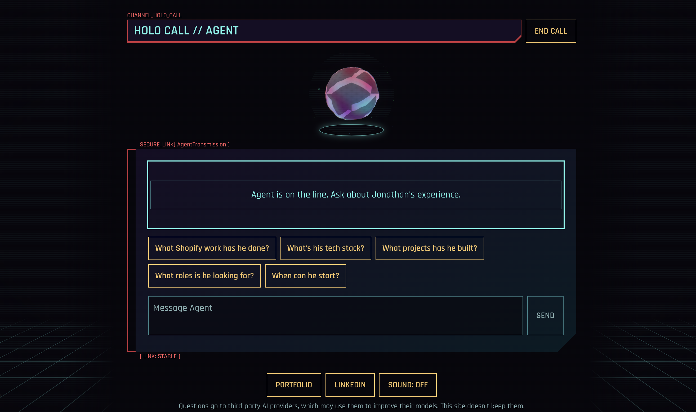

# Holo Call

A cyberpunk "holo call" that answers questions about Jonathan Taft. Visitors accept an incoming call from Agent, Jonathan's AI agent, and ask about his skills, experience and projects. Agent answers only from his CV, LinkedIn and portfolio content.

**[Take the call](https://ai-portfolio-assistant-delta-nine.vercel.app/)**

A CV can't answer follow-up questions, and recruiters rarely have time to dig through a portfolio. Holo Call gives them specific answers on demand, and the app itself is a working example of Jonathan's front-end, animation and AI integration skills.



## Features

- **Incoming call intro:** a caller card with an Accept button, a connecting glitch and the orb materialising into the chat, with a reduced-motion version.
- **Grounded answers:** Agent speaks about Jonathan in the third person and uses only the knowledge base. If it doesn't know something, it says so and points to his contact details.
- **Streaming chat:** answers appear as a live transmission, with suggested questions for common recruiter topics.
- **Animated avatar:** a WebGL orb reacts to the call as it rings, thinks and speaks, with fallbacks for mobile, reduced motion and browsers without WebGL.
- **Provider fallback:** requests try Google Gemini, then Groq, then OpenRouter, so one provider's rate limit or outage doesn't end the call.
- **Abuse protection:** each IP address gets 20 messages every 10 minutes, and message and conversation lengths are capped.
- **Signal lost message:** if allowances run out or every provider fails, Agent shows a message linking to Jonathan's portfolio and LinkedIn.
- **Finishing touches:** optional call sounds (off by default), an end-call screen, a privacy note, a link preview image and a provider health check.

## Tech stack

| Area | Tools |
| --- | --- |
| Framework | Next.js 16 (App Router), React 19, TypeScript |
| Styling | Tailwind CSS v4, custom CSS effects |
| 3D avatar | Three.js, React Three Fiber, postprocessing |
| AI | Vercel AI SDK with Google Gemini, Groq and OpenRouter |
| Rate limiting | Upstash Redis |
| Content tools | mammoth and pdf.js for CV import, Turndown for portfolio import |

There is no database. The knowledge base is a set of markdown files in `content/`, combined at build time and sent to the model as context with each request. Conversations stay in the browser and are not stored on the server.

## Getting started

You need Node.js and an API key for at least one AI provider.

1. Install the dependencies:

   ```bash
   npm install
   ```

2. Create a `.env.local` file in the project root with the variables you need:

   ```bash
   # AI providers: add at least one
   GOOGLE_GENERATIVE_AI_API_KEY=
   GROQ_API_KEY=
   OPENROUTER_API_KEY=

   # Rate limiting: chat runs without a limit if these are missing
   UPSTASH_REDIS_REST_URL=
   UPSTASH_REDIS_REST_TOKEN=

   # Contact links and the site address used in link previews
   NEXT_PUBLIC_PORTFOLIO_URL=
   NEXT_PUBLIC_LINKEDIN_URL=
   NEXT_PUBLIC_SITE_URL=
   ```

3. Start the development server and open [http://localhost:3000](http://localhost:3000):

   ```bash
   npm run dev
   ```

## Scripts

| Command | What it does |
| --- | --- |
| `npm run dev` | Starts the development server |
| `npm run build` | Creates a production build |
| `npm run start` | Serves the production build |
| `npm run lint` | Runs ESLint |
| `npm run import:cv -- path/to/cv.docx` | Drafts `content/cv.md` from a `.docx` or `.pdf` CV for review |
| `npm run import:portfolio` | Drafts `content/portfolio.md` from the live portfolio site for review |

## Updating Agent's knowledge

Edit the markdown files in `content/` and rebuild. No code changes are needed, and any new markdown file in that folder is picked up automatically. Each file starts with front matter giving its `source` and `last_updated` date, so Agent can say how current its information is.

`GET /api/health` reports the app's status and whether each AI provider can be reached.
